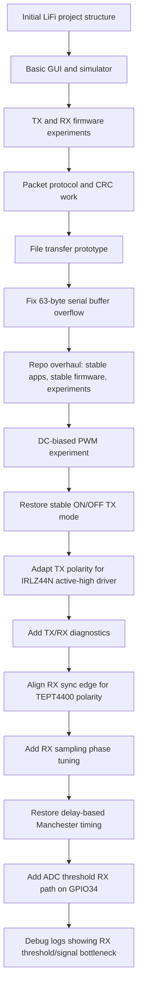
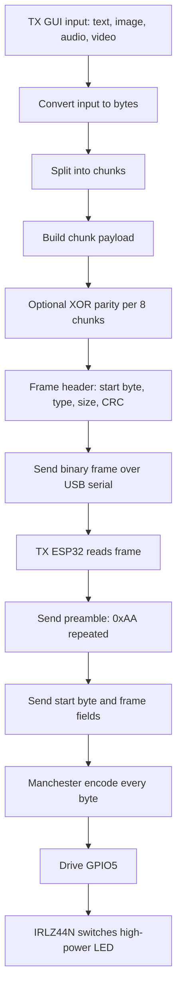
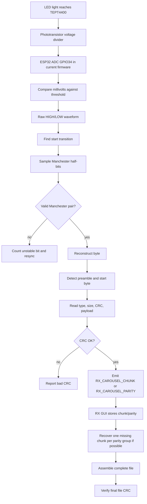
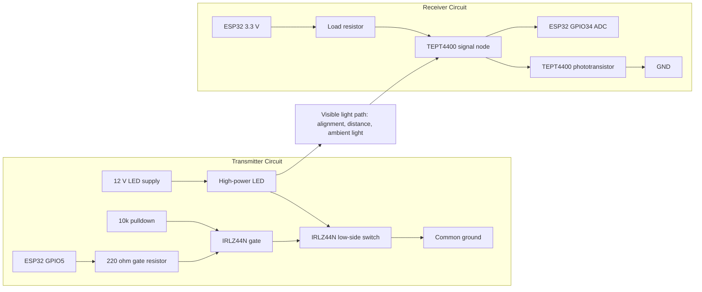
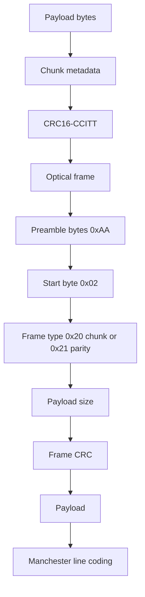
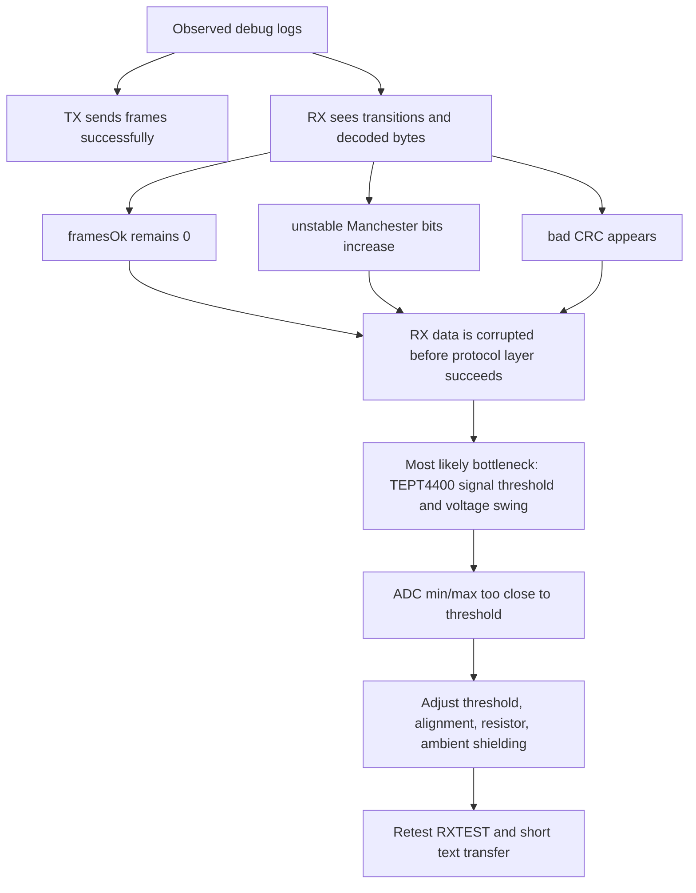
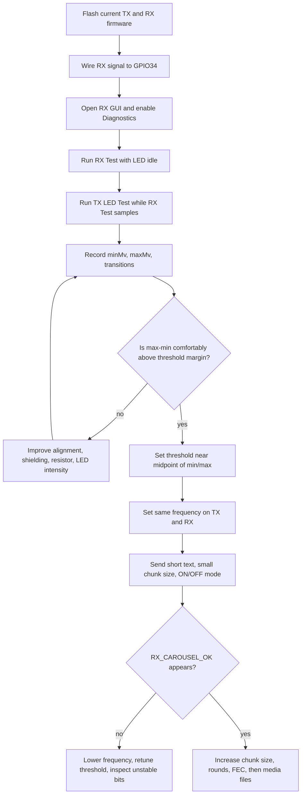

# LiFi Communication System Workflow

This document is a thesis-oriented map of the current LiFi repository and the system it implements. It is meant to become the source model for a later React/Figma-like visual tool where the TX system, RX system, physical circuit, protocol theory, and current bottlenecks can be shown as editable boxes.

## Current Test Status

`pytest` is not installed in either the system Python or the local `.venv`, so `python -m pytest -q` cannot run yet. The existing tests are written with `unittest`, and they pass with:

```bash
.venv/bin/python -m unittest -v tests.test_fec
```

Result:

```text
Ran 2 tests in 0.001s
OK
```

The tests currently cover XOR parity FEC recovery in the desktop protocol layer.

## Repository Evolution

The repo history shows a practical hardware-debug path rather than a clean linear software-only project.



Important commits:

- `0bd112d`: initial GUI and microcontroller sketches.
- `c980c12`: packet-oriented TX/RX work.
- `95080bc`: file-transfer firmware and helper GUI/scripts.
- `c8f96e3`: fixed serial buffer overflow by preventing binary echo.
- `4d78a01`: reorganized into stable apps/firmware and experiments.
- `997d3c7`: restored ON/OFF TX as stable mode after PWM work.
- `d65c327`: corrected TX logic for active-high IRLZ44N low-side MOSFET driver.
- `243fd2d`: added diagnostics and LED/RX test commands.
- `56991ca`: aligned RX sync edge to TEPT4400 waveform polarity.
- `840bd1d`: added RX sampling phase tuning.
- `415f197`: restored simpler delay-based Manchester timing.
- `9fdcd9c`: added ADC thresholding on GPIO34 because GPIO5 digital levels were unreliable.
- latest debug commits: show TX frames are sent, but RX still produces unstable Manchester bits and CRC failures.

## System-Level Workflow


The USB serial links are not the LiFi data channel. They are local control and diagnostics between the computer and each ESP32. The actual communication channel is one-way optical modulation from LED to TEPT4400.

## TX System Workflow



Current TX implementation points:

- Desktop TX GUI: `apps/stable/Tx_gui.py`
- Stable TX firmware: `firmware/stable/tx/tx.ino`
- Optical mode: ON/OFF is the stable mode.
- Experimental mode: DC-biased PWM exists, but it reduces contrast and is harder for the simple TEPT4400 receiver.
- TX driver polarity: active-high IRLZ44N low-side driver, so GPIO HIGH means LED ON.

## RX System Workflow



Current RX implementation points:

- Desktop RX GUI: `apps/stable/Rx_gui.py`
- Stable RX firmware: `firmware/stable/rx/rx.ino`
- Current experiment branch RX uses GPIO5 digital input, restored from the `4d78a01` era, with added debug capture commands.
- GPIO34 ADC capture is available as a diagnostic helper through `ADCAP=...`; it is not the active Manchester decoder on this branch.

## Physical Circuit Flow



The key physical variable is the voltage swing at the TEPT4400 signal node. The RX decoder only works when that signal crosses the chosen threshold cleanly and repeatedly at the Manchester timing rate.

## Protocol Theory



Manchester encoding is used because every data bit contains a transition. That helps the receiver recover timing without a separate clock. In this project, a valid Manchester bit must have opposite first-half and second-half levels. If both halves read the same, RX reports an unstable Manchester bit.

Carousel transfer repeats chunks across rounds. FEC adds one XOR parity frame per group of 8 data chunks. That parity frame can recover exactly one missing chunk in the group. If two or more chunks are missing from the same group, another carousel round is needed.

## Current Bottleneck Map



The latest logs show the ADC threshold was often too close to the measured signal:

- threshold: around `1500 mV`
- observed range: roughly `1244-1593 mV`
- result: almost all samples stayed LOW in some RX tests

That means the receiver is not getting a strong enough digital waveform after thresholding. The TX is probably not the first suspect because the TX logs show frame send markers and LED test support.

## Latest 4d78a Baseline Retest

On branch `experiment/4d78a-rx-current-tx-driver`, the project retested the remembered `4d78a01` RX/TX baseline with only one intentional TX hardware change: TX was patched active-high for the current non-2N3904 driver.

Measured RX phototransistor node:

- idle light ON: about `0.01 V`
- during transmission: about `0.4 V` to `1.5 V`
- low-frequency LED test at `1 Hz` and `30 Hz`: TX visibly turns fully ON/OFF, and RX node swings about `0.1 V` to `3 V`
- historical working point: previous matching RX/TX firmware and circuit setup could transmit text at about `9 kHz`
- current hardware difference from remembered working setup: TX now uses the new MOSFET-only driver without the `2N3904` stage

RX monitor log `debug_logs/rx_gui_monitor_20260519_133207.log` shows:

- `RX_DIGITAL_TEST:durationMs=1000:samples=19238:high=0:low=19238:transitions=0:final=0`
- `RX_STATS:freq=1000:halfBitUs=500:pin=5:raw=0:bytes=3100:unstableBits=4188:badCrc=0:framesOk=0:preambleBytes=0:maxPreambleRun=0`
- decoded byte stream was mostly `0xFF`, with no detected `0xAA` preamble run and no valid frames.

Interpretation:

- The old GPIO5 digital receiver path is not seeing the phototransistor waveform as valid ESP32 logic.
- At `0.4 V` to `1.5 V`, the signal can move on a voltmeter while still staying below the practical digital HIGH threshold of the ESP32 input.
- The failure is happening before CRC/FEC/file reconstruction. The RX protocol never sees a valid preamble or frame.
- Follow-up measurement: the same phototransistor node can rise to about `3.3 V` when no light is received. This means the RX circuit can physically reach HIGH, but during TX transmission the LED may not be fully optically off, or the RX polarity/timing may be wrong for the active-high TX experiment.
- Follow-up low-frequency test: at `1 Hz` and `30 Hz`, TX does fully turn ON/OFF and RX swings about `0.1 V` to `3 V`. This shifts suspicion away from static TX polarity and toward receiver bandwidth, RC settling, sampling phase, or optical contrast collapse at higher symbol rates.
- Historical constraint: because an earlier matched RX/TX setup transmitted text at about `9 kHz`, the project should not assume the RX concept is inherently limited below 9 kHz. The current failure is more likely from a changed TX driver/light source, polarity/idle behavior, RX sampling code, or threshold interpretation compared with the working era.
- Hardware-difference constraint: user reports the main hardware difference from the working era is the new MOSFET-only TX driver without the `2N3904` stage. This makes the TX driver transition behavior at `9 kHz` a leading suspect even though it looks correct at `1-30 Hz`.
- A `1 V` software threshold is not possible on GPIO5 digital mode. It requires ADC threshold mode on an ADC-capable pin such as GPIO34, or an external comparator/Schmitt trigger whose reference is set near `1 V`.
- Supplying the phototransistor front-end from `5 V` may increase voltage swing, but the ESP32 GPIO/ADC input must not be connected directly to a node that can rise above `3.3 V`. If testing a `5 V` sensor supply, protect the ESP32 with a divider, clamp, or comparator output pulled up to `3.3 V`.

Most useful next actions:

- Add a comparator or Schmitt-trigger cleanup stage so RX GPIO5 receives a real 0/3.3 V logic signal.
- Or return to GPIO34 ADC threshold mode and improve it with midpoint thresholding, majority sampling, and edge/phase controls.
- Or temporarily test a pull-up / load-resistor change that makes the RX node cross a real GPIO HIGH level, while watching edge speed at `1-15 kHz`.
- Run a frequency sweep with `RXTEST=1000` at `30, 100, 300, 500, 1000, 3000, 5000, 9000, 12000, 15000 Hz` to find where `transitions` and `high` counts start collapsing.
- Compare the exact `9 kHz` waveform behavior between the remembered working TX driver era and the current active-high TX driver before changing the RX hardware too much.
- Specifically inspect the MOSFET gate, drain/LED node, and RX phototransistor node at `9 kHz`. A multimeter can prove slow ON/OFF, but it cannot prove the waveform has enough rise/fall speed and optical depth at communication rate.
- Added RX capture tools:
  - `RXCAP=durationMs,sampleUs` samples GPIO5 digital level and reports high/low counts, transitions, and min/max run time.
  - `ADCAP=durationMs,sampleUs,thresholdMv` samples GPIO34 ADC and reports min/max/avg mV plus threshold-crossing counts. Use this only after safely wiring the RX sensor node to GPIO34 with voltage limited to `0-3.3 V`.

Latest RX log interpretation:

- `debug_logs/rx_gui_monitor_20260519_143747.log` shows no valid carousel frames.
- Top decoded bytes were mostly `0xFF`, then many `0x55`, with `framesOk=0`, `preambleBytes=0`, and `maxPreambleRun=0`.
- Digital captures at `1000 Hz`, `500 Hz`, and `1 Hz` reported `high=0`, `low=all`, `transitions=0`, so GPIO5 did not see a valid ESP32 HIGH during those capture windows.
- The `1 Hz` capture used only `100 ms`; since a 1 Hz Manchester half-bit is `500 ms`, that short capture can miss transitions. For very slow tests, use longer capture duration such as `RXCAP=2000,100`.
- Repeated `0x55` during slow tests suggests the RX may be seeing an alternating waveform, but with opposite polarity/phase from the current carousel preamble expectation.

## Remembered CRC Packet Era

The user remembers a previous working design that was not the current carousel:

```text
start bit / start marker
data type
  1 = text
  2 = image
  3 = audio
payload data
stop bit / end marker
CRC or simple error check
```

Closest repo match found so far:

- `firmware/experiments/packet_tx/packet_tx.ino`
- `firmware/experiments/packet_rx/packet_rx.ino`
- Introduced around commit `1071b27` (`change`) and present after merge `72a7d84`.
- Packet format in that pair: `SOF=0x7E`, type byte, sequence byte, length byte, payload bytes, XOR CRC byte.
- TX packet type uses ASCII `'T'` for text in that implementation, not numeric `1/2/3`.
- This CRC packet era should be compared separately from the carousel era because it has simpler framing and may be closer to the remembered 9 kHz text success.

## Firmware Pattern Analysis

The firmware history points to a useful separation:

- Reused/likely-working core: Manchester framing, `0xAA` preamble, start byte, CRC-protected frame fields, and the TX/RX GUI chunk/FEC layer.
- Repeatedly changed/unstable area: RX sampling timing, RX edge polarity, RX phase, RX pin mode, and whether RX uses digital GPIO5 or GPIO34 ADC thresholding.
- TX-side churn: the optical waveform is still Manchester, but the driver assumption changed from active-low/inverter style to active-high IRLZ44N low-side drive, and PWM bright/dim experiments were added then pushed back behind ON/OFF mode.

Important historical hardware note:

- Current tracked TX firmware explicitly supports `ACTIVE_LOW_2N3904_INVERTER` as a diagnostic/polarity label.
- Historical `.history/firmware/stable/tx/tx_20260509042644.ino` says the hardware is active-low: GPIO LOW means LED ON and GPIO HIGH means LED OFF.
- The repo text I searched does not name `IRF540N`, so the 2N3904 plus IRF540N era should be treated as user-remembered hardware context unless/until a photo, schematic, notebook entry, or untracked file confirms it.

The strongest debugging rule from the history is: compare each RX firmware against its matching TX era. A receiver that worked with active-low ON/OFF TX at 9-10 kHz may fail with active-high polarity, lower contrast PWM, different sync edge, or single-sample ADC thresholding even if the physical RX circuit did not change.

Historical version ladder now represented in the planner:

- Original millisecond Manchester sketches: simple raw text, TX pin 8, RX GPIO5, slow timing.
- Legacy 1 kHz file-transfer pair: TX pin 8, RX GPIO5, microsecond timing.
- Packet CRC experiment: 1 kHz Manchester, TX pin 8, RX GPIO5, CRC packet state machine.
- 500 Hz file-transfer experiment: slow Manchester, explicit file size/type/CRC framing, GPIO5 digital RX.
- Active-low ESP32 carousel TX: GPIO LOW = LED ON, likely matching the remembered inverter-style TX era.
- `4d78a01`: known-good RX baseline with GPIO5 digital input, 9000 Hz, absolute timing, and `majorityRead()`.
- `d65c327`: active-high IRLZ44N polarity update.
- `243fd2d`: TX/RX diagnostics added while the older digital RX path still existed.
- `56991ca`: TEPT4400 sync-edge alignment.
- `840bd1d`: RX sampling phase tuning.
- `415f197`: delay-based timing restore.
- `997d3c7`: ON/OFF restored as stable after PWM experiments.
- `9fdcd9c`: GPIO34 ADC threshold pivot, the direct ancestor of the current RX bottleneck.

Experimental firmware checked, excluding the DC-biased PWM folder:

- `firmware/experiments/original_tx/original_tx.ino` and `original_rx/original_rx.ino`: raw text Manchester, 1 ms half-bit, TX pin 8, RX GPIO5.
- `firmware/experiments/esp32_tx/esp32_tx.ino`: ESP32 TX variant using GPIO5 but still simple 1 ms Manchester.
- `firmware/experiments/packet_tx/packet_tx.ino` and `packet_rx/packet_rx.ino`: 1 kHz packet experiment with CRC state on RX.
- `firmware/experiments/file_transfer_tx/file_transfer_tx.ino` and `file_transfer_rx/file_transfer_rx.ino`: 500 Hz file transfer with size/type/CRC framing.
- `firmware/experiments/file_transfer_v1_legacy/*`: 1 kHz legacy file-transfer pair.

The non-PWM experimental pattern is consistent: TX framing gets more structured over time, but RX stays a GPIO5 digital Manchester sampler. The current GPIO34 ADC threshold path is therefore a late pivot, not the original receiver model.

## Reliable Commit Comparison

Baseline commit compared here:

```text
4d78a01518c4d2498311b291501e6e98577580e3
```

This is the commit remembered as working well with the same RX circuit.

### RX Firmware Differences

| Area | Commit `4d78a` | Current |
| --- | --- | --- |
| RX input | `#define RX_PIN 5` digital GPIO | `GPIO34` ADC threshold by default, GPIO5 optional |
| Default frequency | `9000 Hz` | `1000 Hz` |
| Default half bit | `55 us` | `500 us` |
| Threshold | ESP32 digital threshold only | firmware threshold, default `1800 mV`, GUI can send `THRESH=` |
| Sync search | waits through HIGH, then waits through LOW; exits on LOW-to-HIGH transition | waits through LOW, then waits through HIGH; exits on HIGH-to-LOW transition |
| Sample timing | absolute `micros()` deadline | relative `delayMicroseconds()` |
| Half-bit read | `majorityRead()` with 3 samples | one `readRxPin()` sample |
| Noise tolerance | higher, because majority read rejects short noise/glitch samples | lower, because a single threshold glitch can corrupt the bit |

Most suspicious RX regression candidates:

1. The sync edge changed. The old code began timing from the opposite transition.
2. Majority sampling was effectively removed from the active decoder path.
3. The ADC threshold mode changed the electrical interpretation of the same sensor circuit.
4. The default frequency changed from `9000 Hz` to `1000 Hz`, which changes optical timing, frame airtime, and how the receiver waits between transitions.

The current file still contains `majorityRead()`, but `receiveManchesterByte()` no longer uses it. That is a strong candidate for a quick recovery experiment: restore majority reads while keeping the newer diagnostics.

### TX Firmware Differences

| Area | Commit `4d78a` | Current |
| --- | --- | --- |
| TX polarity | active-low comment and functions: `LOW = LED ON`, `HIGH = LED OFF` | active-high IRLZ44N mode: `HIGH = LED ON`, `LOW = LED OFF` |
| Default frequency | `9000 Hz` | `1000 Hz` |
| Default half bit | `55 us` | `500 us` |
| Optical modes | ON/OFF only | ON/OFF plus experimental DC PWM |
| Frame gap | `halfBitUs * 80`, clamped `2000-12000 us` | same formula for ON/OFF mode |
| Manchester symbol mapping | start: OFF then ON; 1: ON then OFF; 0: OFF then ON | same logical bright/dim mapping, but polarity abstraction changed |

Most suspicious TX-side item:

- If the physical driver is truly IRLZ44N low-side active-high, the current polarity is correct. If the remembered working circuit still behaved active-low, current `LED_ACTIVE_LOW=false` would invert the optical waveform. The LED Test should settle this: GPIO HIGH should visibly turn the LED on with the current circuit.

### GUI Defaults Differences

| Area | Commit `4d78a` | Current |
| --- | --- | --- |
| TX/RX default frequency | `9000 Hz` | `1000 Hz` |
| Chunk size | `512` | `64` |
| Carousel rounds | `2` | `1` |
| Round gap | `250 ms` | `0 ms` |
| FEC default | on | off unless carousel enabled |
| Frame pacing | fixed `2 ms` sleep after frames | wait for `TX_CAROUSEL_FRAME_SENT` by default, optional frame gap |

The current defaults are safer for debugging but do not reproduce the remembered working setup. For a controlled regression test, use:

- Frequency: `9000 Hz`
- RX input mode experiment: try the old GPIO5 digital path if the hardware is exactly the same
- Chunk size: `512`
- Carousel rounds: `2`
- Round gap: `250 ms`
- FEC: enabled
- TX mode: ON/OFF

For code recovery, test these one at a time:

1. Restore `majorityRead()` in current `receiveManchesterByte()`.
2. Add a runtime `EDGE=LH/HL` option again, or temporarily use the old LOW-to-HIGH sync behavior.
3. Add a compile-time switch for old GPIO5 digital input versus GPIO34 ADC threshold.
4. Verify TX polarity with `LEDTEST` before changing `LED_ACTIVE_LOW`.

## Debug Workflow For The Next Hardware Session



Recommended first recovery settings:

- TX mode: `ON/OFF`
- Frequency: test across `1-15 kHz`; start near `1000 Hz` for debugging, then raise gradually toward the remembered stable `9000 Hz`
- Chunk size: `64` or `256`
- Carousel: on for reliability tests
- FEC: on after basic single-frame decoding works
- RX input: GPIO34 ADC threshold mode
- Threshold: midpoint between measured low and high from `RXTEST`

## Shared ChatGPT Conversation Recovery Clue

The old shared ChatGPT conversation at `https://chatgpt.com/share/69fddf92-1a34-83ec-9f7d-1dd195c277cd` was checked and saved locally as `debug_logs/shared_chatgpt_69fddf92.html`.

That conversation points to a mostly working carousel/file-transfer setup, not a fully dead RX link. The old issue was described as an image transfer missing the final short chunk, while earlier chunks were being stored. The recommended working-style setup there was:

- TX circuit: `2N3904` inverter stage with `IRF540N` gate pull-up.
- TX polarity: active-low idle-ON.
- GPIO `LOW`: LED ON.
- GPIO `HIGH`: LED OFF.
- Test frequency: `9000 Hz`.
- Chunk size: `512` bytes.
- Carousel rounds: `3`.
- GUI behavior: pad the final short chunk during optical transmission, but keep `real_len` so RX saves only real bytes.

Matching local repo history files:

- `.history/firmware/stable/tx/tx_20260509042645.ino`
- `.history/apps/stable/Tx_gui_20260509042013.py`
- `.history/apps/stable/Rx_gui_20260509042004.py`
- `.history/firmware/stable/rx/rx_20260509041644.ino`

The important code difference is not only protocol. The old TX hardware/software pair assumed:

```cpp
txLightOn()  = gpio_set_level(TX_PIN, 0);
txLightOff() = gpio_set_level(TX_PIN, 1);
```

The current MOSFET-only TX can be made to use the same idle/padding rules, but it may still differ electrically because it no longer has the old inverter/gate-drive behavior.

## React Visual Tool Model

For the future web-like React diagram tool, model each box as a node with:

- `id`: stable identifier, such as `tx_gui`, `manchester_encoder`, `tept4400_threshold`
- `layer`: `software`, `firmware`, `circuit`, `optical`, `theory`, or `debug`
- `system`: `tx`, `rx`, `both`, or `physical`
- `status`: `working`, `suspect`, `bottleneck`, `experimental`, or `unknown`
- `evidence`: links to logs, commits, or files
- `parameters`: frequency, threshold, resistor value, chunk size, mode, and pin

Initial bottleneck node:

```json
{
  "id": "rx_adc_threshold",
  "label": "RX ADC threshold and TEPT4400 voltage swing",
  "layer": "circuit",
  "system": "rx",
  "status": "bottleneck",
  "evidence": [
    "debug_logs/lifi_rx_debug_20260517_233519.log",
    "firmware/stable/rx/rx.ino"
  ],
  "parameters": {
    "pin": "GPIO34",
    "thresholdMv": 1500,
    "observedMinMv": 1244,
    "observedMaxMv": 1593
  }
}
```

The first React version should support separate views for:

- Full system flow
- TX-only flow
- RX-only flow
- Physical circuit flow
- Theory/protocol flow
- Bottleneck/debug flow

Later planner/workbench additions now include:

- Electronics-style schematic symbols for ESP32, resistors, MOSFET, LED, phototransistor, photodiode, TIA op-amp, and comparator.
- Editable schematic component values so test changes such as `10k ohm` to `47k ohm` can be captured.
- Per-node and system-level comments for handoff back into Codex.
- A recommendations tab for recovery procedure, receiver signal recovery topics, encoding options, and paper-writing study topics.
- Optional automatic handoff saving through `web/lifi-workflow-planner/server.mjs`; this only works while the planner host device is on.
- Durable context files in `web/lifi-workflow-planner/handoffs/` for future Codex sessions when the planner server is unavailable.
