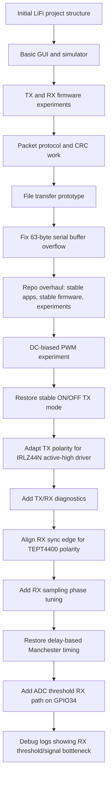
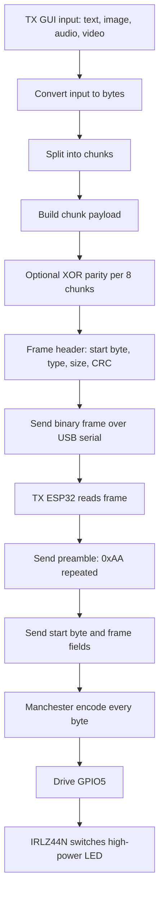
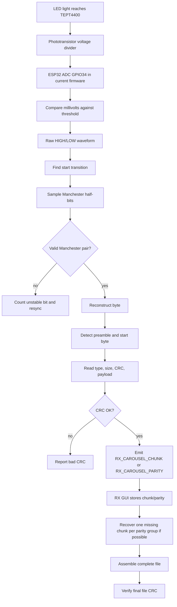
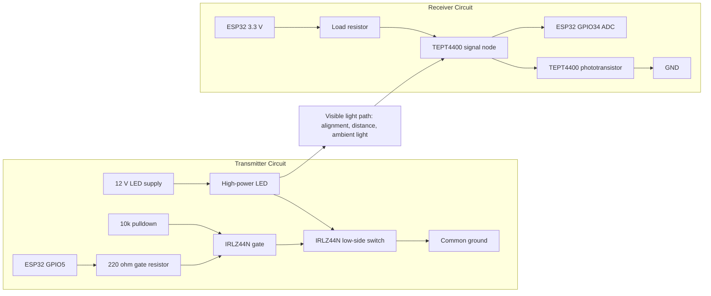
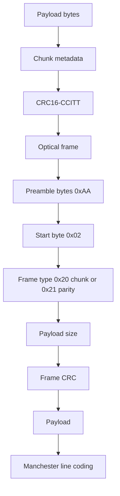
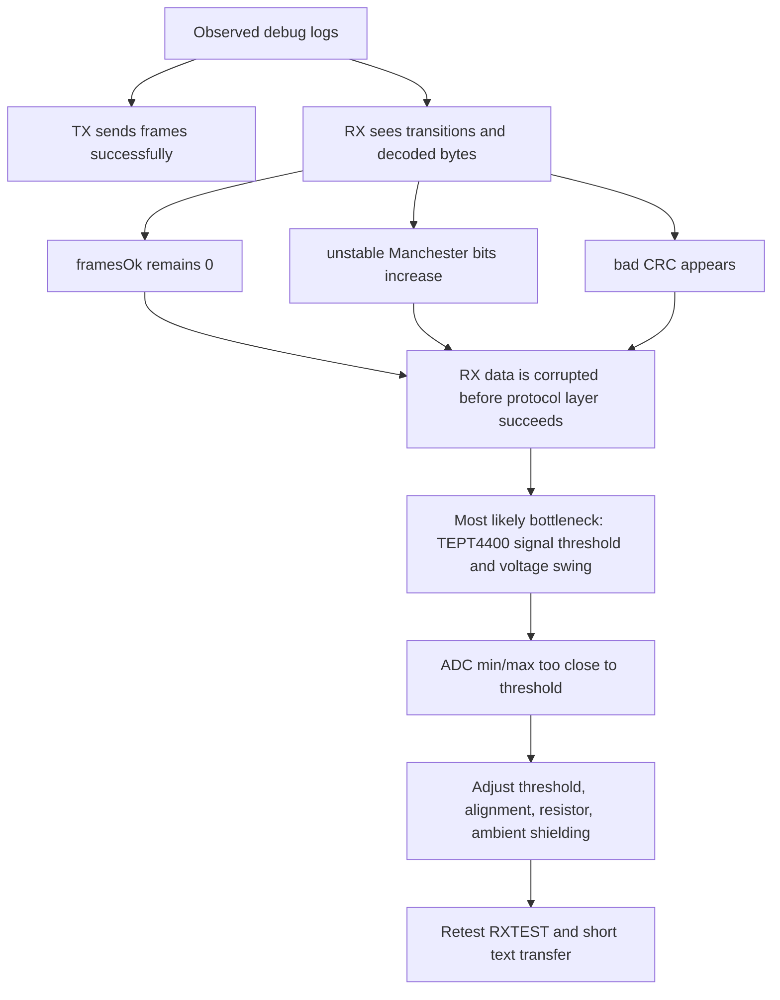
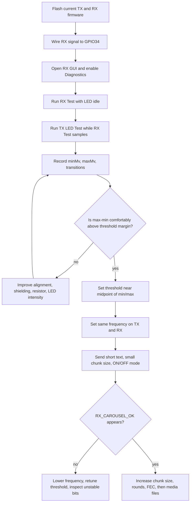

# LiFi Communication System Workflow

This document is a thesis-oriented map of the current LiFi repository and the system it implements. It is meant to become the source model for a later React/Figma-like visual tool where the TX system, RX system, physical circuit, protocol theory, and current bottlenecks can be shown as editable boxes.

## Current Test Status

`pytest` is not installed in either the system Python or the local `.venv`, so `python -m pytest -q` cannot run yet. The existing tests are written with `unittest`, and they pass with:

```bash
.venv/bin/python -m unittest -v tests.test_fec
```

Result:

```text
Ran 2 tests in 0.001s
OK
```

The tests currently cover XOR parity FEC recovery in the desktop protocol layer.

## Repository Evolution

The repo history shows a practical hardware-debug path rather than a clean linear software-only project.



Important commits:

- `0bd112d`: initial GUI and microcontroller sketches.
- `c980c12`: packet-oriented TX/RX work.
- `95080bc`: file-transfer firmware and helper GUI/scripts.
- `c8f96e3`: fixed serial buffer overflow by preventing binary echo.
- `4d78a01`: reorganized into stable apps/firmware and experiments.
- `997d3c7`: restored ON/OFF TX as stable mode after PWM work.
- `d65c327`: corrected TX logic for active-high IRLZ44N low-side MOSFET driver.
- `243fd2d`: added diagnostics and LED/RX test commands.
- `56991ca`: aligned RX sync edge to TEPT4400 waveform polarity.
- `840bd1d`: added RX sampling phase tuning.
- `415f197`: restored simpler delay-based Manchester timing.
- `9fdcd9c`: added ADC thresholding on GPIO34 because GPIO5 digital levels were unreliable.
- latest debug commits: show TX frames are sent, but RX still produces unstable Manchester bits and CRC failures.

## System-Level Workflow


The USB serial links are not the LiFi data channel. They are local control and diagnostics between the computer and each ESP32. The actual communication channel is one-way optical modulation from LED to TEPT4400.

## TX System Workflow



Current TX implementation points:

- Desktop TX GUI: `apps/stable/Tx_gui.py`
- Stable TX firmware: `firmware/stable/tx/tx.ino`
- Optical mode: ON/OFF is the stable mode.
- Experimental mode: DC-biased PWM exists, but it reduces contrast and is harder for the simple TEPT4400 receiver.
- TX driver polarity: active-high IRLZ44N low-side driver, so GPIO HIGH means LED ON.

## RX System Workflow



Current RX implementation points:

- Desktop RX GUI: `apps/stable/Rx_gui.py`
- Stable RX firmware: `firmware/stable/rx/rx.ino`
- Current RX code uses ADC threshold mode on GPIO34.
- The older GPIO5 digital input path is still present but is not the current recovery direction.

## Physical Circuit Flow



The key physical variable is the voltage swing at the TEPT4400 signal node. The RX decoder only works when that signal crosses the chosen threshold cleanly and repeatedly at the Manchester timing rate.

## Protocol Theory



Manchester encoding is used because every data bit contains a transition. That helps the receiver recover timing without a separate clock. In this project, a valid Manchester bit must have opposite first-half and second-half levels. If both halves read the same, RX reports an unstable Manchester bit.

Carousel transfer repeats chunks across rounds. FEC adds one XOR parity frame per group of 8 data chunks. That parity frame can recover exactly one missing chunk in the group. If two or more chunks are missing from the same group, another carousel round is needed.

## Current Bottleneck Map



The latest logs show the ADC threshold was often too close to the measured signal:

- threshold: around `1500 mV`
- observed range: roughly `1244-1593 mV`
- result: almost all samples stayed LOW in some RX tests

That means the receiver is not getting a strong enough digital waveform after thresholding. The TX is probably not the first suspect because the TX logs show frame send markers and LED test support.

## Reliable Commit Comparison

Baseline commit compared here:

```text
4d78a01518c4d2498311b291501e6e98577580e3
```

This is the commit remembered as working well with the same RX circuit.

### RX Firmware Differences

| Area | Commit `4d78a` | Current |
| --- | --- | --- |
| RX input | `#define RX_PIN 5` digital GPIO | `GPIO34` ADC threshold by default, GPIO5 optional |
| Default frequency | `9000 Hz` | `1000 Hz` |
| Default half bit | `55 us` | `500 us` |
| Threshold | ESP32 digital threshold only | firmware threshold, default `1800 mV`, GUI can send `THRESH=` |
| Sync search | waits through HIGH, then waits through LOW; exits on LOW-to-HIGH transition | waits through LOW, then waits through HIGH; exits on HIGH-to-LOW transition |
| Sample timing | absolute `micros()` deadline | relative `delayMicroseconds()` |
| Half-bit read | `majorityRead()` with 3 samples | one `readRxPin()` sample |
| Noise tolerance | higher, because majority read rejects short noise/glitch samples | lower, because a single threshold glitch can corrupt the bit |

Most suspicious RX regression candidates:

1. The sync edge changed. The old code began timing from the opposite transition.
2. Majority sampling was effectively removed from the active decoder path.
3. The ADC threshold mode changed the electrical interpretation of the same sensor circuit.
4. The default frequency changed from `9000 Hz` to `1000 Hz`, which changes optical timing, frame airtime, and how the receiver waits between transitions.

The current file still contains `majorityRead()`, but `receiveManchesterByte()` no longer uses it. That is a strong candidate for a quick recovery experiment: restore majority reads while keeping the newer diagnostics.

### TX Firmware Differences

| Area | Commit `4d78a` | Current |
| --- | --- | --- |
| TX polarity | active-low comment and functions: `LOW = LED ON`, `HIGH = LED OFF` | active-high IRLZ44N mode: `HIGH = LED ON`, `LOW = LED OFF` |
| Default frequency | `9000 Hz` | `1000 Hz` |
| Default half bit | `55 us` | `500 us` |
| Optical modes | ON/OFF only | ON/OFF plus experimental DC PWM |
| Frame gap | `halfBitUs * 80`, clamped `2000-12000 us` | same formula for ON/OFF mode |
| Manchester symbol mapping | start: OFF then ON; 1: ON then OFF; 0: OFF then ON | same logical bright/dim mapping, but polarity abstraction changed |

Most suspicious TX-side item:

- If the physical driver is truly IRLZ44N low-side active-high, the current polarity is correct. If the remembered working circuit still behaved active-low, current `LED_ACTIVE_LOW=false` would invert the optical waveform. The LED Test should settle this: GPIO HIGH should visibly turn the LED on with the current circuit.

### GUI Defaults Differences

| Area | Commit `4d78a` | Current |
| --- | --- | --- |
| TX/RX default frequency | `9000 Hz` | `1000 Hz` |
| Chunk size | `512` | `64` |
| Carousel rounds | `2` | `1` |
| Round gap | `250 ms` | `0 ms` |
| FEC default | on | off unless carousel enabled |
| Frame pacing | fixed `2 ms` sleep after frames | wait for `TX_CAROUSEL_FRAME_SENT` by default, optional frame gap |

The current defaults are safer for debugging but do not reproduce the remembered working setup. For a controlled regression test, use:

- Frequency: `9000 Hz`
- RX input mode experiment: try the old GPIO5 digital path if the hardware is exactly the same
- Chunk size: `512`
- Carousel rounds: `2`
- Round gap: `250 ms`
- FEC: enabled
- TX mode: ON/OFF

For code recovery, test these one at a time:

1. Restore `majorityRead()` in current `receiveManchesterByte()`.
2. Add a runtime `EDGE=LH/HL` option again, or temporarily use the old LOW-to-HIGH sync behavior.
3. Add a compile-time switch for old GPIO5 digital input versus GPIO34 ADC threshold.
4. Verify TX polarity with `LEDTEST` before changing `LED_ACTIVE_LOW`.

## Debug Workflow For The Next Hardware Session



Recommended first recovery settings:

- TX mode: `ON/OFF`
- Frequency: test across `1-15 kHz`; start near `1000 Hz` for debugging, then raise gradually toward the remembered stable `9000 Hz`
- Chunk size: `64` or `256`
- Carousel: on for reliability tests
- FEC: on after basic single-frame decoding works
- RX input: GPIO34 ADC threshold mode
- Threshold: midpoint between measured low and high from `RXTEST`

## React Visual Tool Model

For the future web-like React diagram tool, model each box as a node with:

- `id`: stable identifier, such as `tx_gui`, `manchester_encoder`, `tept4400_threshold`
- `layer`: `software`, `firmware`, `circuit`, `optical`, `theory`, or `debug`
- `system`: `tx`, `rx`, `both`, or `physical`
- `status`: `working`, `suspect`, `bottleneck`, `experimental`, or `unknown`
- `evidence`: links to logs, commits, or files
- `parameters`: frequency, threshold, resistor value, chunk size, mode, and pin

Initial bottleneck node:

```json
{
  "id": "rx_adc_threshold",
  "label": "RX ADC threshold and TEPT4400 voltage swing",
  "layer": "circuit",
  "system": "rx",
  "status": "bottleneck",
  "evidence": [
    "debug_logs/lifi_rx_debug_20260517_233519.log",
    "firmware/stable/rx/rx.ino"
  ],
  "parameters": {
    "pin": "GPIO34",
    "thresholdMv": 1500,
    "observedMinMv": 1244,
    "observedMaxMv": 1593
  }
}
```

The first React version should support separate views for:

- Full system flow
- TX-only flow
- RX-only flow
- Physical circuit flow
- Theory/protocol flow
- Bottleneck/debug flow

Later planner/workbench additions now include:

- Electronics-style schematic symbols for ESP32, resistors, MOSFET, LED, phototransistor, photodiode, TIA op-amp, and comparator.
- Editable schematic component values so test changes such as `10k ohm` to `47k ohm` can be captured.
- Per-node and system-level comments for handoff back into Codex.
- A recommendations tab for recovery procedure, receiver signal recovery topics, encoding options, and paper-writing study topics.
- Optional automatic handoff saving through `web/lifi-workflow-planner/server.mjs`; this only works while the planner host device is on.
- Durable context files in `web/lifi-workflow-planner/handoffs/` for future Codex sessions when the planner server is unavailable.
