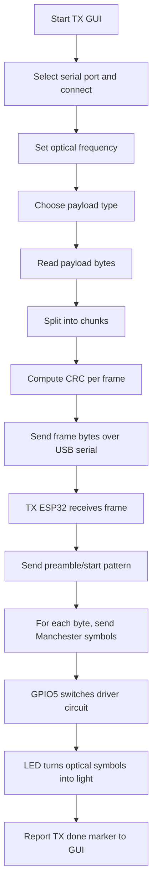
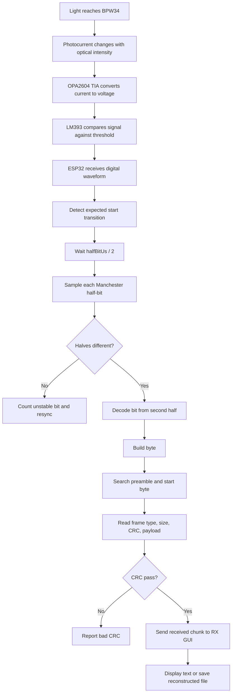
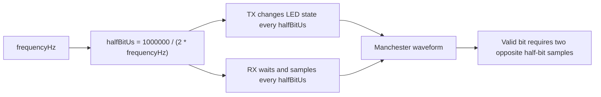
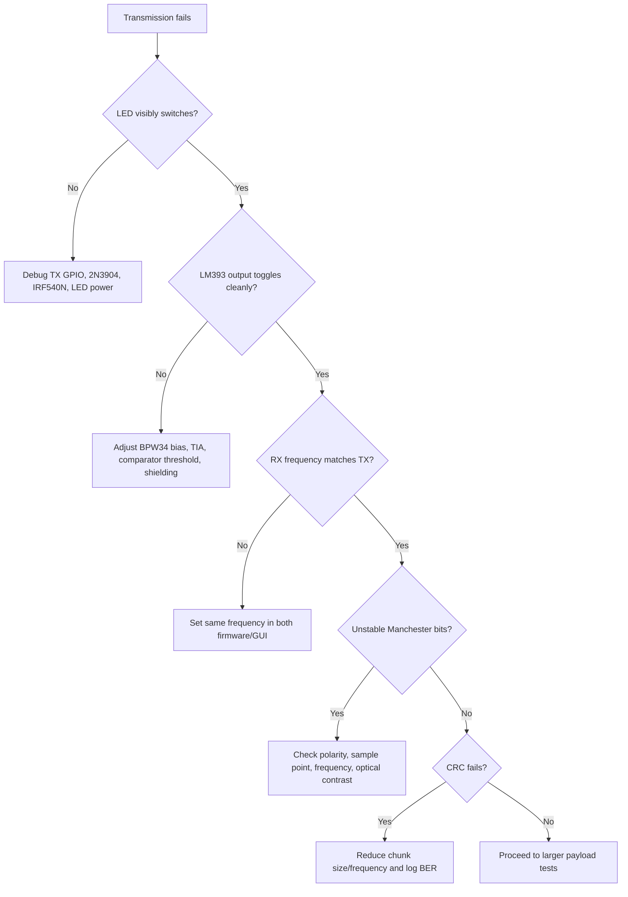

# LiFi System Flowcharts

These flowcharts are written in Mermaid so they can be rendered by GitHub,
Markdown preview extensions, and many documentation tools.

## Whole System: TX To RX

```mermaid
flowchart LR
    A[User selects text/image/audio/video] --> B[TX GUI converts data to bytes]
    B --> C[Frame builder adds metadata and CRC]
    C --> D[USB serial sends frame to TX ESP32]
    D --> E[TX firmware Manchester-encodes bytes]
    E --> F[GPIO5 drives 2N3904 + IRF540N]
    F --> G[12 V DC LED emits modulated visible light]
    G --> H[Free-space optical path]
    H --> I[BPW34 converts light to photocurrent]
    I --> J[OPA2604 TIA converts current to voltage]
    J --> K[LM393 comparator produces logic waveform]
    K --> L[RX ESP32 samples Manchester half-bits]
    L --> M[RX firmware validates frame and CRC]
    M --> N[RX GUI reconstructs and displays/saves data]
```

## TX System Flow

## RX System Flow

## Physical Layer Timing Flow

## Debug Flow

